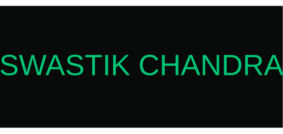
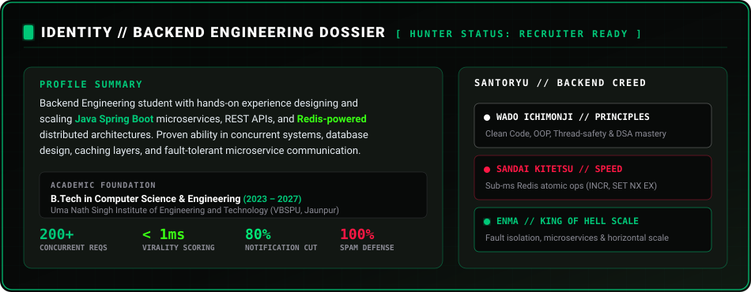
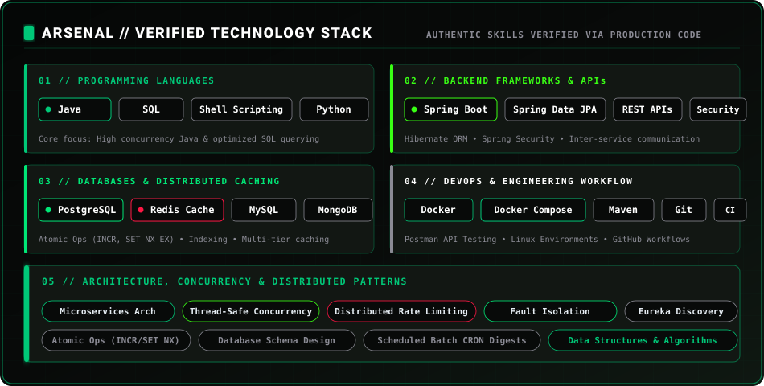
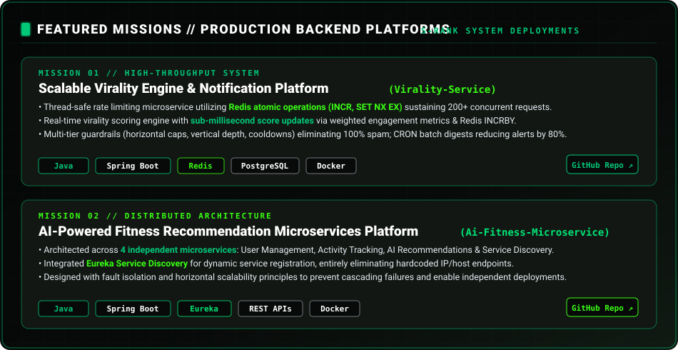
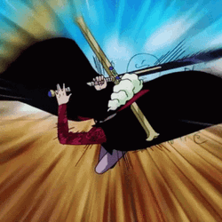
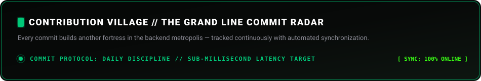
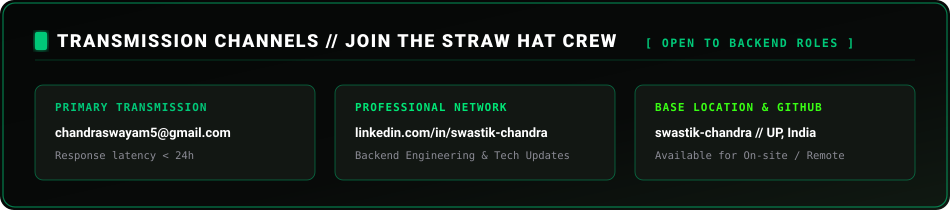

<!-- ⚔️ HERO BANNER: ZORO KING OF HELL / SWASTIK CHANDRA -->

  

<!-- 🗡️ ANIME HIGHLIGHT: ZORO BATTLE STANCE -->

  

<!-- 📜 DEVELOPER IDENTITY & ACADEMIC FOUNDATION -->

  

<!-- 🟢 ANIME HIGHLIGHT: ENMA EMERALD ENERGY & KING OF HELL AURA -->

  

<!-- 🛠️ TECHNOLOGY ARSENAL: VERIFIED STACK -->

 

<!-- QUICK BADGE PILLS -->

  
  
  
  
  
  
  

 

<!-- 🎯 FEATURED MISSIONS / S-RANK PLATFORMS -->

## ⚔️ S-Rank Backend Deployments

<table>
  <thead>
    <tr>
      <th>Mission Code</th>
      <th>Architectural Breakthrough</th>
      <th>San-Ken Stack</th>
      <th align="center">System Telemetry</th>
    </tr>
  </thead>
  <tbody>
    <tr>
      <td>
        <a href="https://github.com/swastik-chandra/Virality-Service">
          <b>🗡️ Virality-Service</b>
        </a>
         
        Scalable Virality Engine &amp; Notification Platform
      </td>
      <td>
        High-throughput microservice engineering thread-safe rate limiting via <b>Redis atomic operations</b> (<code>INCR</code>, <code>SET NX EX</code>), sustaining <b>200+ concurrent requests</b> with zero race conditions. Real-time scoring updates (&lt;1ms) via <code>INCRBY</code> and CRON batch digests reducing notification overhead by <b>80%</b>.
      </td>
      <td>
        <code>Java</code>
        <code>Spring Boot</code>
        <code>Redis</code>
        <code>PostgreSQL</code>
        <code>Docker</code>
      </td>
      <td align="center">
        
      </td>
    </tr>
    <tr>
      <td>
        <a href="https://github.com/swastik-chandra/Ai-Fitness-Microservice">
          <b>🗡️ Ai-Fitness-Microservice</b>
        </a>
         
        AI-Powered Fitness Recommendation Microservices
      </td>
      <td>
        Distributed architecture partitioned across <b>4 independent microservices</b> (User Management, Activity Tracking, AI Recommendations, Service Discovery). Employs <b>Eureka Service Discovery</b> to eradicate hardcoded endpoints with strict fault isolation and horizontal scalability.
      </td>
      <td>
        <code>Java</code>
        <code>Spring Boot</code>
        <code>Eureka</code>
        <code>REST APIs</code>
        <code>Docker</code>
      </td>
      <td align="center">
        
      </td>
    </tr>
  </tbody>
</table>

 

  

<!-- 🗡️ ANIME HIGHLIGHT: SANTORYU OUGI THREE SWORDS STYLE -->

  

<!-- 📊 GITHUB SYSTEM TELEMETRY & ANALYTICS -->
### ⚡ Hunter Telemetry &amp; System Analytics

  
  

  

 

<!-- 🏙️ 3D CONTRIBUTION METROPOLIS & RADAR -->

 

  

<!-- 📡 TRANSMISSION CHANNELS: JOIN THE CREW -->

 

  
  &nbsp;
  
  &nbsp;
  

 

<!-- PROFILE VISITOR COUNTER -->

  

<!-- ⛩️ CINEMATIC FOOTER: NOTHING HAPPENED -->

 

  <b>“Nothing happened. Just another day of building.”</b>
   
  <i>The World's Greatest Swordsman never looks back. Master the blade, master the backend.</i> ⚔️

